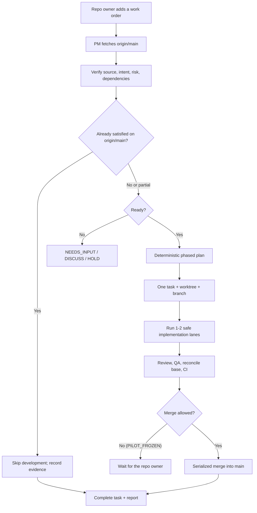

# Autonomous Engineering Orchestration

> Purpose: canonical contract for structured work orders executed by automations
> (Claude Code). This document adds narrow automation exceptions to the
> `AGENTS.md` flow; it never weakens repository planning, testing, review, QA,
> handoff, migration, or CI gates.
> Scope: the `OwlRepo/pick-a-booth` repository only.
> State: **PILOT_FROZEN** (`.ai-engineering/config/autonomous-engineering.yaml`).

## Day-to-day flow



## Task source

Task source is repository markdown: work orders live in `.ai-engineering/tasks/Tasks.md`
(added through a PR like any other change). The repo owner owns intent and
authorization there; generated execution state belongs in the task's plan under
`docs/plans/`.

## Work-order schema

Only unchecked top-level list items below `## New Tasks` are tasks. One task has this exact shape:

```md
- [ ] Short action-oriented title
  - Mode: AUTO
  - Priority: P2
  - Outcome: One observable result
  - Acceptance:
    1. Given a starting condition, when an action occurs, then the result is observable.
  - Sources:
    - Type: MANUAL
      Ref: issue link, file path, URL, or copied message
      Evidence: Relevant fact
  - Constraints:
    - Behavior that must not change
  - Known dependencies: NONE
  - Deadline: NONE
  - Notes: NONE
```

Enums:

- `Mode`: `AUTO`, `DISCUSS`, `HOLD`, `HOTFIX`
- `Priority`: `P0`, `P1`, `P2`, `P3`
- Source type: `MEETING_TRANSCRIPT`, `MEETING_RECORDING`, `CHAT`, `BUG_REPORT`, `MANUAL`, `OTHER`

Parsing rules:

1. Field labels and enum spelling are exact.
2. Blank values are invalid; use `NONE`.
3. Acceptance criteria are numbered lines, never nested checkboxes.
4. Every accessible source is read. Important plan facts cite its reference and evidence.
5. Before planning or dispatch, compare the outcome and every acceptance item against freshly fetched `origin/main`: implementation, usages, tests, routes, schemas, configuration, and relevant history. A matching title, nearby feature, or similar symbol is not proof.
6. When every acceptance item is already satisfied, record `SKIPPED_ALREADY_IMPLEMENTED` with the inspected SHA and exact files, symbols, tests, commits, and behavior evidence. Create no plan, worker, branch, worktree, or PR.
7. When only part is satisfied, record which acceptance items are proven and which remain. Plan only the missing gap.
8. Missing fields, placeholder text, contradictory evidence, or unclear acceptance enters `NEEDS_INPUT`; notify once and continue other work.
9. The coordinator appends a unique `^PAB-####` block ID to the title line. It never rewrites user-authored outcome, acceptance, source, or constraints.
10. Editing an active task enters `SCOPE_CHANGED`. Replanning is automatic only when outcome and acceptance remain unchanged.
11. Holding or deleting an active task stops future actions without deleting its branch, worktree, commits, or evidence.
12. A task is checked only after its merged SHA is on `origin/main` and its validation evidence is recorded.

## Risk and authorization

The PM assigns risk from task and repository evidence, records the affected contracts, blast radius, rollback shape, and cited files, and does not guess.

- `LOW`: localized, reversible, no shared data/auth/hardware impact.
- `MEDIUM`: multiple components or visible behavior, backward compatible.
- `HIGH`: admin auth, the unauthenticated API surface, migrations, plugin hookspecs, camera backends, system commands, CI/packaging, or broad blast radius.
- `VERY_HIGH`: destructive migration, irreversible action on user data, security/access change, or uncertain rollback.

A `PAB-####` work order is a standing authorization envelope only when its required fields and sources are valid, the deterministic plan exactly matches its outcome and acceptance, and no product decision or scope expansion exists.

- `AUTO` Low/Medium/High: bounded planning and implementation may continue.
- Evidence-backed Low/Medium/High bug RCA may continue into its bounded fix.
- Low/Medium: PR creation is autonomous; merging is autonomous only after activation (below).
- High: implementation is autonomous; exact PR and SHA approval is required to merge.
- Very High: exact plan-version approval is required before code, then exact PR and SHA approval before merge.
- `DISCUSS`: investigate and plan only.
- `HOLD`: do nothing.
- `HOTFIX`: highest queue priority, but no gate is bypassed.

Approval commands are accepted only from the repo owner:

```text
APPROVE PLAN PAB-#### v#
APPROVE RELEASE PR-#### <commit-sha>
REJECT PAB-#### <reason>
ACTIVATE LOW/MEDIUM AUTONOMOUS RELEASE
```

Manual/ad-hoc tasks without a valid envelope keep the default explicit approval rules in `AGENTS.md` and `docs/ai/handoff.md`.

## Origin freshness and app-managed worktrees

Local `main` is never a baseline. The PM fetches `origin`, prunes stale refs, records the current `origin/main` SHA, and reads code from that commit. Fetch failure blocks new work.

Before each task starts:

1. Fetch `origin` again.
2. Verify the planned base still equals `origin/main`.
3. Create the worktree from that ref (a harness-managed Claude Code worktree, or `scripts/new-task-worktree.sh`).
4. Record worktree path, branch, `base_sha`, and `last_synced_sha`.

A worker in a harness-managed worktree verifies it is not the primary checkout and that no other task owns the branch; it must not run `scripts/new-task-worktree.sh` again. Fetch and compare with `origin/main` before implementation, final QA, PR creation, and merge. If upstream invalidates code facts but not the approved outcome, increment the plan version and regenerate the plan. Scope or product-behavior changes stop for a decision.

## Phase and model routing

Every phase declares and records its primary (model, reasoning) pair, minimum capability, and ordered sufficient fallbacks. The primary pair is the least excessive pair that is still more than sufficient. Repository personas keep the pairs generated from `agents/src/*.agent.toml`.

A normal phase exit requires its observable outcome, required validation, a focused commit, no unrelated diff, and a recorded end SHA.

- Same next pair: continue in the owning task.
- Different pair: stop at the validated checkpoint; resume with the exact next pair only under a standing authorization envelope. Very High still waits for approval.

When the exact pair is unavailable, choose the closest sufficient declared fallback and record why. If no sufficient pair exists, enter `BLOCKED_EXTERNAL` and notify. A quota failure inside a phase preserves the diff and evidence; the fallback resumes the same phase.

## Slicing, concurrency, and lifecycle

Large work is split into the fastest safe vertical slices, each useful, backward compatible, testable, and mergeable on its own. Each slice owns one task, branch, and worktree.

- One implementation lane for High/Very High, migrations, auth, hookspecs, or heavy validation.
- Two lanes otherwise, only for disjoint work with no shared schema, API, config field, or symbol ownership.
- Expensive validation, PR integration, and merge are serialized.

Lifecycle:

```text
INBOX -> TRIAGED -> PLANNED -> EXECUTING -> PHASE_CHECKPOINT -> REVIEW -> QA
-> PR_READY -> CI_WAIT -> MERGE_READY -> MERGED -> DONE
```

Exceptional states: `NEEDS_INPUT`, `DISCUSS`, `HOLD`, `BLOCKED_HUMAN`, `BLOCKED_EXTERNAL`, `SCOPE_CHANGED`, `CONFLICT_REVIEW`, `FAILED`, `CARRYOVER`, `RELEASE_FROZEN`, and `SKIPPED_ALREADY_IMPLEMENTED`. The skipped state never dispatches an implementation worker. These map onto `.ai-engineering/core/task-state-machine.md`.

## Conflict and repair policy

After every merge, compare active branches with the new `origin/main` across files, symbols, APIs, schemas, migrations, config, tests, and business rules. Material overlap reconciles promptly.

Automations may resolve only mechanical conflicts: imports, formatting, non-behavioral documentation, clearly additive exports, and generated files regenerated from source (`uv run poe agents:generate`). Never use blanket ours/theirs or an unleased force push. Behavior, migration, auth, security, or API/schema conflicts enter `CONFLICT_REVIEW` with both intents, the conflicting files/commits, options, and the validation required after a human decision.

Each failing gate receives at most three evidence-changing fix-and-retest cycles. Repeating the same unsuccessful action is forbidden. The fourth failure enters `BLOCKED_HUMAN` with the attempted fixes and the recommended next action.

## Review, merge, and activation gates

No PR is created until all phases and acceptance criteria are complete, review has no unresolved P0/P1/P2 finding, relevant tests pass, docs are synchronized, rollback is documented, and the branch is reconciled with `origin/main` (`docs/ai/handoff.md` Integration sequence step 3). PRs follow `docs/ai/pr-evidence.md`.

Only one PR enters final integration at a time:

1. Acquire the release lock (one merge in flight).
2. Fetch and reconcile with `origin/main`; rerun affected gates.
3. Push with `--force-with-lease` only when an already-pushed rebased branch's remote SHA is unchanged.
4. Create the PR (`gh pr create --repo OwlRepo/pick-a-booth --base main`).
5. Require green CI (`gh pr checks <number>`) and an unchanged reviewed/tested head SHA.
6. Apply the risk approval gate and merge serially with a merge commit.
7. Fetch the resulting `origin/main`; reassess every remaining branch.

The fork has no deployment of its own; "release" means the merge into `main`. No autonomous revert of `main`: a failure after merge sets `RELEASE_FROZEN`, preserves evidence, and notifies.

**Pilot mode (current state, `PILOT_FROZEN`):** planning, implementation, review, QA, PR, and CI run; nothing merges. Low/Medium autonomous merge activates only after the repo owner sends `ACTIVATE LOW/MEDIUM AUTONOMOUS RELEASE`; the recommended checkpoint is reviewing one complete pilot task first. The activation is recorded in `.ai-engineering/memory/project-memory.md` and in the config `activation` key. High and Very High gates never deactivate.

## Schedule and notifications

No schedule is configured (`.ai-engineering/config/autonomous-engineering.yaml` `schedule: NONE`); automations run on demand. Notify only for `ACTION REQUIRED`, `FAILED`, `RELEASED`, and `EOD READY`; routine progress stays in the task's plan and state.
