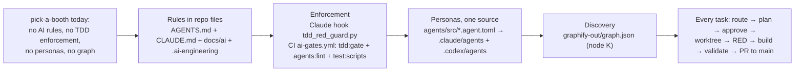

# Port the engineering workflow from tarraula-command-center to pick-a-booth

## Context

Romeo wants pick-a-booth to run the same engineering workflow as `tarraula-command-center`: route, plan, approve, build in a worktree, validate, hand off. The rules live in repo files, are enforced by hooks and CI, and behave the same under Claude Code and Codex.

The reference is a Next.js/Supabase app. pick-a-booth is a **public fork** of `photobooth-app/photobooth-app`: Python ≥3.11, FastAPI, uv, poe, pytest, ruff, basedpyright, and SQLite through SQLAlchemy/Alembic. It has a prebuilt Vue3 bundle and **no Node tooling**. So every script and doc is adapted to this stack, not copied. The reference repo stays read-only.

Decisions already taken (AskUserQuestion, 2026-10-13):

- **D1.** Tooling is Python stdlib plus poe tasks.
- **D2.** Mirror the reference's installed `.ai-engineering/` package: merge duplicate files, remove Tarraula refs, add an explicit `activation: PILOT_FROZEN` key.
- **D3.** Use the home-relative caveman path `~/.agents/skills/caveman/SKILL.md`.
- **D4.** Commit `graphify-out/` built with stock graphify only. No augmentation scripts.
- **D5.** All text is English only, including the PR. No Spanish.

### Task Classification
```
Task Classification:
- Intent: port AI engineering workflow (rules + hooks + CI + personas)
- Workflow: INFRASTRUCTURE (required analysis: env, change, compat, secrets, rollback, validation)
- Task Size: LARGE
- Domain: repo tooling / CI / docs (no src/photobooth runtime change)
- Risk: MEDIUM — CI gate + edit-blocking hook can block contributors; zero app-runtime change
- Contract Areas: none (no API/DB change)
- Next Action: approve plan → worktree → Phase 1
```

### Flowchart


### Metadata
- **Docs loaded:** `planning.md, plan-template.md`. Read from the reference this session; the port carries them over.
- **Claims reversed while investigating:**
  1. "The reference runs the bootstrap installer output." False. `AUTONOMOUS_ENGINEERING_BOOTSTRAP.md` was never executed there: no `manifest.yaml`, `rules/` or `schemas/`.
  2. "The reference config holds frozen/pilot keys." False. `.ai-engineering/config/autonomous-engineering.yaml` only has `autonomy_level: 2`. Pilot state lives in prose at `docs/ai/autonomous-engineering.md:289-293`.
  3. "The reference gitignores worktrees." False. It ignores them only through `.git/info/exclude`; `settings.local.json` is ignored only through the global git ignore.
- **Detected running model:** Opus 5.5 (`claude-opus-5-5`). Every phase is `Opus 5.5, high`, so phases run back-to-back with no model-switch stop. Fallback: Sonnet 5.5, high, but only for Phase 4 docs. Using it would force a switch stop.
- **Branch:** `infra/no-ticket-ai-workflow-port`, cut from fresh `origin/main` (`e2db0d33`).
- **Release path:** one PR into `OwlRepo/pick-a-booth:main` using **"Create a merge commit"**. That keeps the `test(...)` RED commit visible ahead of the implementation commit.
  - Evidence: `git ls-remote --heads origin` returns only `main`. The fork has no deploy. `cicd.yml` and the RPi and codecov jobs are gated on `repository_owner == 'photobooth-app'`. Branch protection is off (API 404). Actions are enabled with no runs yet.
  - **Gotcha:** `gh pr create` in a fork defaults to the upstream parent. Always pass `--repo OwlRepo/pick-a-booth --base main`.
- **Execution preflight:** `gh auth switch --user OwlRepo` (repo owner = OwlRepo).

---

## Gap matrix

| Reference artifact | Here? | Action | Stack substitutions |
|---|---|---|---|
| `AGENTS.md` | no | create/adapt | Next.js warning block dropped. Persona line becomes "Python/FastAPI, SQLAlchemy/Alembic on SQLite, camera/GPIO hardware on Raspberry Pi/Linux, Docker". Caveman path `~/...`. Release node W says PR → `main`. Dev-env pointer goes to local `uv run photobooth`. The TAR-#### paragraph points at the frozen pilot. |
| `CLAUDE.md` | no | create | `@AGENTS.md` first, then verified facts with evidence paths (section P4.2). |
| `AI_WORKFLOW.md`, `PLANNING_STANDARDS.md` | no | create stubs | pointers only; "Supabase discipline" becomes "DB discipline" |
| `docs/ai/task-router.md` | no | adapt | Same enums, skills and block. The Deep list becomes auth/admin, config persistence, migrations, plugins/hookspecs, hardware backends, share/sync. Polyglot note covers the Python app, vendored JS bundle, PHP shareondemand and GHA. |
| `planning.md`, `plan-template.md` | no | adapt | Supabase discipline becomes SQLAlchemy/SQLite discipline. Migrations rule now names Alembic, run at app start on field devices. i18n, mobile and idb sections dropped (no frontend source here). Commands use `uv run poe ...`. |
| `execution.md` | no | adapt | Worktree script, RED via `uv run poe tdd:red`, pytest, `poe lint` |
| `handoff.md` | no | adapt | Release flow becomes the single PR → `main` described above. Completion Gate, status block and Graphify gate are kept. Learnings go to `.ai-engineering/memory/lessons-learned.md`, so no root `learnings.md`. |
| `testing-strategy.md` | no | adapt | Strict TDD with pytest function-name prefixes `test_error_` > `test_edge_` > `test_regression_` > `test_happy_`. Layers: unit pytest, migration tests, regression, smoke via `uv run photobooth` + `/api/doc`. Hardware tests self-skip. No e2e layer: `src/web/` is a vendored build. |
| `agent-orchestration.md` | no | adapt | Personas renamed, ownership globs re-cut, zone briefings become module briefings (routers, services, backends, plugins, DB, web) |
| `entry-point`, `context-refresh`, `operating-contract` | no | adapt | Verification sources become pyproject, routers, alembic versions, the pytest suite |
| `autonomous-engineering.md` | no | adapt | Obsidian, Codex project id and Asia/Manila schedule removed. Task source = REPOSITORY_MARKDOWN. State = `PILOT_FROZEN`; no autonomous merge or release until `ACTIVATE LOW/MEDIUM AUTONOMOUS RELEASE`. IDs become `PAB-####`. |
| `module-ownership-map`, `risk-register`, `architecture-manifest` | no | create from evidence | Rows per layer: routers/api (unauthenticated), api_admin (JWT), services, backends, plugins, database, config, web. Risks: plaintext admin password compare + per-process JWT secret, `/api/*` unauthenticated, import-time side effects, migrations on user devices, hardware-only test paths. |
| `dev-environment.md` | no | create | `uv venv --system-site-packages && uv sync`; `uv run photobooth` on :8000; admin/`0000` default; runtime dirs created in CWD; VirtualCamera backend for no-hardware use; Docker image. No remote DEV env exists, so live checks run on localhost in Brave. |
| `pr-evidence.md` | no | adapt | Uses the existing `.github/pull_request_template.md` sections plus `## TDD evidence`, `## Risk`, `## Rollback`. English only. |
| `contracts/api-contracts.md`, `contracts/db-contracts.md` | no | create | API: router groups + auth model, source of truth `/api/openapi.json`. DB: 4 tables, revision invariant, alembic chain. |
| `file-index/repository-map.md` | no | create | `symbol -> path:line` for key entry points only, each verified |
| `prompts/{bugfix-rca,bugfix-plan,feature-plan,refactor-plan}.md` | no | adapt | Graphify first; pytest; helper candidates (`container`, `appconfig`, `BaseService`, `pluginmanager`, `utils/*`) |
| `docs/ai/cron-simtest-guide.md` | no | **skip** | Tarraula-only (Next cron routes). Its generic mutation-check idea moves into testing-strategy. |
| `.ai-engineering/` (agents, config, core, memory, runtime, templates, validation, workflows, SETUP.md) | no | mirror (D2) | Six duplicate pairs merged into one file each. Kept: `decision-framework`, `evidence-policy`, `blocker-handling`, `bug-fix`, `daily-cycle`, `feature-development`, `release-process`. Config adds `activation: PILOT_FROZEN`. `autonomy-levels.md` points at this repo's handoff. |
| `AUTONOMOUS_ENGINEERING_BOOTSTRAP.md` | no | **skip copy** | Used as the spec only, for activation semantics. A full install was declined (D2). |
| `agents/src/*.agent.mjs` + prompts | no | adapt | Becomes `agents/src/<name>.agent.toml` (stdlib `tomllib`) + `prompts/<name>.md` (P3) |
| `scripts/generate-agent-defs.mjs` + test | no | rewrite to Python | `scripts/generate_agent_defs.py` + `scripts/tests/test_generate_agent_defs.py` |
| `.claude/agents/*.md`, `.codex/agents/*.toml` | no | generate | Never hand-edited |
| `.claude/settings.json` hook | no | create | Matcher `Edit\|Write\|MultiEdit\|NotebookEdit\|Bash` runs `python3 "$CLAUDE_PROJECT_DIR/scripts/hooks/tdd_red_guard.py"` |
| `scripts/hooks/tdd-red-guard.mjs` + test | no | rewrite | `scripts/hooks/tdd_red_guard.py` |
| `scripts/ci/{tdd-lib,tdd-red,tdd-gate,tdd-runner}.mjs` + tests | no | rewrite | `scripts/ci/{tdd_lib,tdd_red,tdd_gate,tdd_runner}.py`. The runner switches from node:test TAP to pytest `--junitxml` parsed with stdlib `xml.etree`. |
| `scripts/ci/test-repo.mjs` | no | rewrite | `scripts/tests/repo_fixture.py`. Renamed so pytest does not collect it. |
| `scripts/ci/verified-tree.mjs` + test | no | **skip** | It needs a persistent self-hosted runner dir (`/var/lib/tarraula-ci`). GitHub-hosted runners have none, so a port would never hit. Gap, not a guess. |
| `scripts/new-task-worktree.sh` | no | adapt | Same logic; base `origin/main` |
| `scripts/git-hooks/pre-commit` + `prepare` | no | **skip** | Python has no `prepare` install hook. Commits to main are still blocked by the workflow rule, and branch protection is a separate decision (see Open questions). |
| npm scripts `agents:*`, `tdd:*`, `test:scripts` | no | poe tasks (D1) | `uv run poe agents:generate` and so on |
| `.github/workflows/ci.yml` gate steps | no | new `.github/workflows/ai-gates.yml` | A separate file keeps upstream syncs of `linter.yml`/`pytests.yml` conflict-free. `agents:lint` runs always (under 1 s, simpler than the reference's path filter). |
| graphify node K + plan/closeout phases | graphify CLI ✓ (`~/.local/bin/graphify`) | port rules + baseline (D4) | `scripts/graphify/*` not ported: db_bridge, pg_objects, route_map, i18n and infra are Supabase/Next/Tarraula-specific. `ci_workflows.py` is a deferred gap. |
| `.claude/PRPs/` | no | skip | Tarraula feature artifacts |
| `.gitignore` worktrees / settings.local | no | add | `.claude/worktrees/`, `.claude/settings.local.json` |

**Existing Claude setup:** none (no CLAUDE.md, AGENTS.md, .claude, .codex, cursor or copilot files). Nothing to merge or overwrite. `settings.local.json` and secrets are absent; `.vscode/sftp.json` stays untouched.

**Conflicts with existing repo conventions:** my resolution is in **bold**. Override any at approval.

1. `CONTRIBUTING.md:107` uses branch `feature/my-feature`. The workflow uses `feat/no-ticket-<name>`. **Keep CONTRIBUTING as-is for upstream contributors; agent work uses the workflow naming.**
2. Existing tests are named `test_<subject>_<case>` (~284). **Grandfathered: the gate checks only test names a diff adds.**
3. The PR template already exists with Motivation, Changes, Testing, Checklist, Focus and "AI used". **Keep it; pr-evidence appends TDD evidence, Risk and Rollback blocks inside the body. Do not edit the template.**
4. `dependabot.yml` targets the `dev` branch, which does not exist on the fork. **Out of scope; listed as a residual risk.**

---

## Phases (all `Opus 5.5`, high → continuous)

### Phase 0: Preflight
1. Run `gh auth switch --hostname github.com --user OwlRepo`.
2. Run `git fetch origin`.
3. Add `.claude/worktrees/` to the primary checkout's `.git/info/exclude`. This is local and untracked; it follows the reference pattern. Then run `git worktree add .claude/worktrees/infra-ai-workflow-port -b infra/no-ticket-ai-workflow-port origin/main`. The script doesn't exist yet, so this one time the step is done by hand.
4. Run `uv venv --system-site-packages && uv sync` inside the worktree. This installs the existing lock with no dependency changes.
5. Record the baseline: `uv run poe lint` and `uv run poe test`, both pre-existing. Any failure gets recorded as a pre-existing unrelated failure, per stop condition Z.
6. Copy this plan to `docs/plans/ai-workflow-port.md` and commit it alone as `docs(ai-workflow): approved plan`.

Done: worktree on the branch, baseline results recorded.

### Phase 1: RED for the tooling itself
Write the pytest tests first. Names use the prefixes and are declared in order `test_error_*` > `test_edge_*` > `test_regression_*` > `test_happy_*`. Each test mirrors a reference test case (agent inventory §4), translated to pytest and Python paths:

- `scripts/tests/repo_fixture.py`: `make_repo(base_files)` creates a temp git repo with a `main` base commit, a faked `refs/remotes/origin/main`, and a `feature` branch. Includes the sample `src/photobooth/vat.py` buggy/fixed code and `src/tests/tests/test_vat.py`.
- `scripts/tests/test_tdd_lib.py`: covers `classify_changes`, `parse_waivers`, `extract_test_names` (AST; skips `@pytest.fixture`; handles async defs and methods of `class Test*`), `check_names`, `parse_junit_failures`, `judge_red`, `find_bash_write_targets`, and `is_guarded_source`.
- `scripts/tests/test_tdd_red.py`, `test_tdd_gate.py`, `test_tdd_red_guard.py`, `test_generate_agent_defs.py`: the same case lists as the reference, minus the `[id]` glob, e2e and promotion-to-dev/stg cases, which don't apply.
- `scripts/tests/test_doc_links.py` (new, durable): every backticked repo path and relative md link in `AGENTS.md`, `CLAUDE.md`, `docs/ai/**` and `.ai-engineering/**` must exist. It also checks every persona `owned_globs` entry is documented in `docs/ai/agent-orchestration.md`. This replaces a one-off link check with a permanent guard.

Run `uv run pytest scripts -q` and paste the output. Expected result: every module fails to import (file-level RED, the valid RED kind). Commit as `test(ai-workflow): RED for tdd guard, gate, generator, doc links`.

Done: committed tests that fail only because the modules are missing.

### Phase 2: TDD tooling + hook + worktree script
Rules, defined once here:

- **Guarded source:** `^src/photobooth/.+\.py$` except `src/photobooth/database/alembic/versions/`.
- **unit:** `^src/tests/tests/(.+/)?test_[^/]*\.py$`
- **migrationTests:** the unit pattern with `migration` in the name. These can run here because the DB is in-process SQLite.
- **migrations:** `^src/photobooth/database/alembic/versions/.+\.py$`
- **scriptTests:** `^scripts/(.+/)?test_[^/]*\.py$`
- **Not runnable:** benchmarks `src/tests/benchmarks/*_test.py`.
- **No `ui` kind:** `src/web/**` is a vendored build.
- **Runnable kinds:** unit, migrationTests, scriptTests.
- **Waivers:** `TDD-Waiver:` and `Migration-Waiver:` lines in the PR body, case-insensitive, with a reason required. `TDD-Waiver: refactor ...` means the tests must PASS at the base.
- **Promotion skip:** `TDD_GATE_HEAD_REF == "main"` covers upstream-sync PRs.
- **Valid RED:** at least one failing `error`/`edge`/`regression` test, or a collection failure, which is how a missing module shows up.
- **Marker:** `<git-dir>/tdd-red.json`, one per worktree.

Files:

- `scripts/ci/tdd_lib.py`: pure functions implementing the rules above.
- `scripts/ci/tdd_runner.py`: runs `sys.executable -m pytest -p no:cacheprovider --basetemp=<tmp> --junitxml=<tmp>/r.xml <files>` with `cwd=<root>`, `PYTHONPATH=<root>/src`, and a timeout. Returns the failures.
- `scripts/ci/tdd_red.py`: base is `TDD_RED_BASE` or `origin/main`. Also accepts `--waiver "<reason>"`. Exit codes: 0 = RED recorded, 1 = no RED, 2 = usage error.
- `scripts/ci/tdd_gate.py`: same flow as the reference, using `git worktree add --detach` at the merge-base and `GITHUB_STEP_SUMMARY`. Messages in English.
- `scripts/hooks/tdd_red_guard.py`: stdlib only. Exit 2 = block, 0 = allow, and it fails open on bad JSON.
- `scripts/new-task-worktree.sh`: the reference logic with the same type list.
- `pyproject.toml` `[tool.poe.tasks]`: add `"agents:generate"`, `"agents:lint"`, `"tdd:red"`, `"tdd:gate"`, `"test:scripts"` (`pytest scripts`). Nothing else changes.
- `.claude/settings.json`: the hook.
- `.gitignore`: add `.claude/worktrees/` and `.claude/settings.local.json`.

Run `uv run poe test:scripts`; the TDD and hook tests should be green.

Done: all `scripts/tests` pass except the generator and doc-link tests, which Phases 3–4 turn green.

### Phase 3: Personas (single source)
- Source format `agents/src/<name>.agent.toml`: `name`, `file_prefix`, `description`, `owned_globs`, `[claude] tools, model`, `[codex] model, model_reasoning_effort, sandbox_mode, mcp_servers`. The prompt lives in `agents/src/prompts/<name>.md`. Models and tools copy the reference roster: claude `sonnet`, codex `gpt-5.6-sol`, with effort and sandbox per the reference table.
- `scripts/generate_agent_defs.py` writes `.claude/agents/NN-name.md` and `.codex/agents/name.toml`. It appends `GLOBAL_POLICY` (caveman `~/` path, adapted persona line, graphify-first rule, AGENTS flow, `.ai-engineering` reads, migrations rule naming the repo owner). `--check` fails on drift, a missing file, an orphan file, a duplicate `owned_globs`, or `"""` in a prompt.
- Roster: generic personas keep their reference prefixes; specialists are swapped.

| prefix | name | replaces | owned_globs |
|---|---|---|---|
| 01 | project-manager | — | — |
| 02 | db-architect | supabase-architect | `src/photobooth/database/alembic/versions/*.py`, `src/photobooth/database/models.py` |
| 03 | web-frontend-dev | nextjs-frontend-dev | `src/web/frontend/**`, `src/web/sharepage/**`, `src/web/shareondemand/**` |
| 04 | ui-ux-designer | — | — |
| 05 | code-reviewer | — | — |
| 06 | security-auditor | — | — |
| 07 | test-engineer | — | — |
| 08 | accessibility-auditor | — | — |
| 09 | fastapi-backend-dev | be-agent | `src/photobooth/routers/**`, `src/photobooth/services/**`, `src/photobooth/plugins/**`, `src/photobooth/utils/**`, `src/photobooth/database/schemas.py` |

- **Ownership split** (carried from the reference rules 1–5, adapted):
  - BE owns the contract (Pydantic schemas, router signatures).
  - FE consumes `/api` only and drops built bundles from photobooth-frontend.
  - db-architect runs alone first whenever models or migrations change.
  - Any file outside these globs (`appconfig.py`, `container.py`, `application.py`, `__init__.py`, `__main__.py`) is assigned explicitly by the PM at contract lock.
- Prompts are rewritten for this stack (FastAPI DI via `container`, pydantic-settings config, pluggy hookspecs at `src/photobooth/plugins/__init__.py`, hardware self-skip tests). They contain no Tarraula text.
- Run `uv run poe agents:generate` then `uv run poe agents:lint`.

Done: 18 generated files, lint clean, generator tests green.

### Phase 4: Rules docs
1. `AGENTS.md` blocks, in order: ai-engineering-integration, the CLAUDE.md pointer, caveman-ultra-policy (`~/` path), session persona (P3 line), core principles 1–10 + 6b (`uv run poe tdd:red`), the strict-flow-policy mermaid A–Z with node rules (K = graphify, W = handoff with single PR → main), the structured work orders paragraph (PILOT_FROZEN), the agent-routing-policy (P3 names, `uv run poe agents:generate`), and development environment → `docs/ai/dev-environment.md`.
2. `CLAUDE.md` starts with `@AGENTS.md`, then these sections, each fact with its evidence path:
   - What it is (README.md, pyproject `description`)
   - Fork relation (`gh api` fork:true, parent)
   - Real stack (pyproject deps/versions)
   - Layers (the layer map above)
   - Conventions (ruff line 150, basedpyright standard, `uv run poe lint|format|test`)
   - DB rules (SQLite path, alembic at startup via `create_db_and_tables`, revision invariant `models.py:58-60`)
   - Config rules (`env_nested_delimiter="__"`, JSON-beats-env source order `baseconfig.py`)
   - How agents operate (worktree, branch naming, PR `--repo OwlRepo/pick-a-booth --base main`, merge commit, `gh pr checks`, no protection)
   - Don't-do list (no new deps unasked, no import-time side effects added, no edits to the vendored `src/web/frontend` by hand, no secrets in `.vscode/sftp.json`, do not touch upstream-gated CI jobs)
3. Write `AI_WORKFLOW.md` and `PLANNING_STANDARDS.md` as stubs, plus every `docs/ai/*` file and `.ai-engineering/*` file per the gap matrix. Every doc gets the Purpose / Load rule / Source of truth header. Unknowns are marked `TODO: Fill after repository analysis. Do not treat as verified.` Fix the reference's stale refs: `testing-strategy`→handoff "Docs and learning sync", and the obsolete execution.md quote in pr-evidence.

Done: `test_doc_links.py` green, and `grep -riE "tarraula|juanfer|supabase|next\.js|vercel|hetzner|sx65|contabilidad|español"` over the new files returns nothing.

### Phase 5: CI
Add `.github/workflows/ai-gates.yml`:
- Trigger: `pull_request`, concurrency per ref.
- Runner: `ubuntu-latest`, `actions/checkout@v7` with `fetch-depth: 0`, `astral-sh/setup-uv@v8.2.0` with py 3.14.
- Setup steps: the same apt line as `pytests.yml` linux, then `uv sync --all-extras --dev`.
- Steps:
  1. `uv run poe agents:lint`
  2. `uv run poe test:scripts`
  3. `uv run poe tdd:gate` with env `TDD_GATE_BASE=origin/${{ github.base_ref }}`, `TDD_GATE_HEAD_REF=${{ github.head_ref }}`, `PR_BODY`.
- `permissions: contents: read`.

Done: the workflow parses (`gh workflow view` after push) and runs on the PR.

### Phase 6: Graphify baseline + full validation
1. `/graphify .` builds `graphify-out/` (no viz above 5,000 nodes), plus the nested `graphify-out/.gitignore` copied from the reference's list. Report the node and edge counts and the token figures, labelled actual or estimate per planning.md.
2. Run the Validation section below and paste every output.

### Phase 7: Handoff (`docs/ai/handoff.md` as ported)
1. Commit per phase: `test(...)`, `feat(ai-workflow): ...`, `docs(ai-workflow): ...`, `ci(ai-workflow): ...`, `chore(graphify): baseline`.
2. Run `git fetch origin`, then rebase on `origin/main` (the branch is still unmerged). Re-run validation.
3. Push with `git push --set-upstream origin infra/no-ticket-ai-workflow-port`.
4. Run `gh pr create --repo OwlRepo/pick-a-booth --base main`. The title and body are **English only**, in plain language, with no Co-Authored-By trailer. The body fills the existing template sections plus TDD evidence, Risk and Rollback.
5. Run `gh pr checks <n>` and wait for green. Do not merge.
6. Final report plus the exact status block.

---

## Validation (real runs, output pasted)
- `uv run poe agents:generate && uv run poe agents:lint` → "lint passed (9 personas, 18 files)".
- `uv run poe test:scripts` → all of `scripts/tests` green, including doc links.
- **Hook proof**, by direct stdin, deterministic. This session's hook config comes from the primary checkout, so a live-session proof needs a new session started in the worktree; it is optional and offered.
  - (a) Feed `echo '{"tool_name":"Edit","cwd":"<wt>","tool_input":{"file_path":"src/photobooth/utils/helper.py"}}' | python3 scripts/hooks/tdd_red_guard.py`. Expected: exit 2 with the "RED first" message.
  - (b) Add a scratch failing `src/tests/tests/utils/test_zz_tdd_probe.py` (`test_error_probe` asserting False), run `uv run poe tdd:red` (exit 0, marker written), and repeat (a). Expected: exit 0.
  - (c) Delete the probe and the marker; nothing of it gets committed.
- `uv run poe lint` (basedpyright + ruff check + format check) is green, and that includes the new `scripts/` Python.
- `uv run poe test` matches the Phase 0 baseline exactly, so no regression.
- `test_doc_links.py` covers "every relative path resolves".
- After the PR: `gh pr checks` shows `ai-gates`, `lint` and `tests` all green.

## Rollback
- Everything is additive: new files plus a 2-line `.gitignore` addition, 5 poe task lines and 1 new workflow. Pre-merge rollback is closing the PR. Post-merge: `git revert -m 1 <merge-sha>` through a PR.
- Hook escape hatch: `uv run poe tdd:red --waiver "<reason>"`, or delete `.claude/settings.json`'s hook entry.
- The CI gate escape is a `TDD-Waiver:` line in the PR body. Pushing a commit re-reads the body; editing the body alone doesn't.

## Open questions / UNVERIFIED (each resolved by a check, never guessed)
1. **UNVERIFIED:** whether poe accepts `:` in task names and appends extra args (needed for `tdd:red --waiver`). Checked in Phase 2 with `uv run poe --help` and `uv run poe tdd:red --waiver x`. If either fails, the single fallback is hyphen names `agents-generate`, `tdd-red` and so on. The docs are written after Phase 2, so they quote the verified form.
2. **UNVERIFIED:** whether `PYTHONPATH=<base-worktree>/src` shadows the uv editable install of `photobooth`, which the gate needs to run base code. Checked in Phase 2 with `PYTHONPATH=/tmp/x/src uv run python -c "import photobooth;print(photobooth.__file__)"`. If it fails, the runner switches to `python -I` with an explicit `sys.path` bootstrap.
3. **UNVERIFIED:** whether the Codex model id `gpt-5.6-sol` is valid. It is carried from the reference and can't be verified from this machine.
4. **Decision for you, not blocking:** whether to enable branch protection on `main` (required `ai-gates`). It is off today. The reference also runs without it and relies on `gh pr checks` by hand.
5. **Residual risks:**
   - `dependabot.yml` targets the missing `dev` branch.
   - The CI gate job installs the full deps (opencv, onnx), adding about 3–5 minutes per PR.
   - Gate runs of changed tests that need hardware or the PHP shareondemand server will self-skip, so they can't prove RED. A waiver is needed there.
   - The hook needs `python3` ≥3.8 on PATH; it is 3.14 here.
