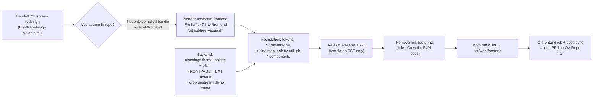

## Pick-a-Booth v2 UI — vendor frontend source + 1:1 redesign

TL;DR: The booth's screens ship as a pre-compiled bundle copied from upstream, so we can't restyle them here today. It's like owning a printed poster without the design file. We pull the frontend source into this repo, pinned to the exact upstream commit the current bundle came from. Then we re-skin all 22 screens to match the handoff design 1:1 (dark "party booth" look, event colour palette, big touch buttons), remove upstream branding and links, add one admin setting (the 5-colour event palette), and rebuild the bundle. Booth logic, API, state machine and SSE stay the same.

### Flowchart (high-level)



### Task metadata

- Classification: `ENHANCEMENT` · `LARGE` · domains `web` + `config` + `tooling` · risk Deep (config persistence: new persisted field + changed defaults; see `docs/ai/risk-register.md` "Config persistence")
- Docs loaded: `planning.md, plan-template.md` (plus `task-router.md`, `prompts/feature-plan.md`, `module-ownership-map.md`, `risk-register.md`, `testing-strategy.md`, `execution.md`, `handoff.md`, `pr-evidence.md`, `agent-orchestration.md`). Read from the merged origin/main content in worktrees `infra-desktop-ci` @ `6410fca9` and `infra-ai-workflow-port` @ `b5adf0f5`. The local `main` checkout is stale at `e2db0d33` and lacks these docs.
- Claims reversed while investigating:
  1. "Frontend source must live in the separate photobooth-frontend repo" (handoff header, `CLAUDE.md` "What it is"). Reversed by owner decision: vendor it here.
  2. "Spinner colours cycle t1–t5" (handoff §2). Design L379 indexes `p[i%5]` over 8 non-centre cells, so only t1–t4 ever show. The reference wins.
  3. "64px pill" (handoff §2). The design has no 64h pill; heights are 60/52/40.
  4. "QR plate 118–140". The design uses 118 (L) and 120 (P) only.
  5. "Boomerang tile and badge get t5 by type". There is no `boomerang` action group (`GroupActions` fields `image, collage, animation, video, multicamera`, `actions.py:332-493`) and no boomerang `media_type`: boomerang is the flag `VideoProcessing.boomerang` (`actions.py:253`). Tiles therefore use the handoff's literal "default by index"; boomerang items get the Video badge.
- Detected running model: Claude Opus 5.5 (`claude-opus-5-5`).
- Recommended model: `opus`, high reasoning, for every phase. The work is pixel-faithful porting across 22 artboards plus a config contract. Identical pairs mean no switch stops. Confidence high. Fallback: `sonnet` high for Phase 6 docs only, which would force a switch stop.
- Minimum capability: Opus-class. The work translates inline-styled design markup into scoped Vue SFC CSS and must preserve about 40 element ids plus the props, emits and config flags enumerated in Phase 4.
- Branch: `feat/no-ticket-booth-redesign-v2` (from `origin/main` = `444086c7`)
- Release path: one branch → one PR into `main` of `OwlRepo/pick-a-booth`, merge commit (`docs/ai/handoff.md` "Release flow"). Owner chose a single PR.
- Required skills: `ecc:plan`, `ecc:model-route`, `graphify`, `/qa`, `ecc:code-review`, `ecc:vue-review`, `ecc:python-review`, `claude-in-chrome` (Brave, deviceId `4075da5e-5c8f-4a6f-9b9e-d6f23e896cea`).
- Agent routing (`AGENTS.md` "Automatic agent routing", `docs/ai/agent-orchestration.md`):
  1. `project-manager` confirms the spec.
  2. Contract lock (section below).
  3. `test-engineer` writes RED.
  4. `fastapi-backend-dev` (Phase 2) runs in parallel with `web-frontend-dev` (Phases 3–5).
  5. Verify.
  6. QA fan-out: `test-engineer`, `code-reviewer`, `security-auditor`, `accessibility-auditor`, `ui-ux-designer`.

  No `db-architect`: there is no DB or migration change.
- Execution preflight: `git fetch origin`, then `scripts/new-task-worktree.sh feat booth-redesign-v2`, then inside the worktree `uv venv --system-site-packages && uv sync`. Node ≥ 22 (verified locally: Node `v25.0.0`, npm `11.6.2`).

### Owner decisions (AskUserQuestion, this session)

1. Frontend source lives in this repo ("already a fork") → vendored at `frontend/`.
2. Brand: name `Pick-a-Booth`. Logo and favicon are generated from the design's own mark (dc.html L9 thumbnail SVG: four rounded squares in t1–t4 on `#0a0b10`).
3. Single PR.
4. The `FRONTPAGE_TEXT` default becomes plain text `Pick-a-Booth`.

### Contract (locked before RED)

| Item | Old | New | Persisted? |
|---|---|---|---|
| `uisettings.theme_palette` | — | `list[Color]`, exactly 5, default `["#ff4d2e","#ff3d9a","#ffc933","#3d6bff","#22d39a"]`, JSON-serialized as `#rrggbb` via `as_hex(format="long")` | yes; additive with a default, so an old `config.json` loads unchanged |
| `uisettings.FRONTPAGE_TEXT` default | styled HTML div | `"Pick-a-Booth"` | saved values untouched |
| `uisettings.livestream_frameoverlay` default | enabled, `frame_image_photobooth-app.png` | `FrameOverlay(enable=False, image=None, mirror_effect=True)` | saved values untouched (see R1) |
| `GroupActions.image[0].processing.img_frame` default | enabled, same PNG | `FrameOverlay(enable=False, image=None, mirror_effect=False)` | same |
| `GroupActions.image[0].processing.texts_enable` / text | `True` / "Visit photobooth-app.org and build yours!" | `False` / "Pick-a-Booth" | same |
| `GET /api/config` response | no `theme_palette` | adds `uisettings.theme_palette` (5 hex strings) | — |

No route, DB, SSE, store or hookspec change.

Verified in memory this session (`.venv/bin/python -I`):
- A `list[Color]` field with `min_length=5, max_length=5, validate_default=True` plus a `field_serializer` dumps the default as 5 hex strings.
- `['red','#fff','rgb(0,0,255)',…]` dumps as `['#ff0000','#ffffff','#0000ff',…]`, and `['red']` raises `ValidationError`.
- The JSON schema carries `default`, `minItems`/`maxItems: 5` and `items.format: color`, with no `PydanticJsonSchemaWarning`.
- Without the serializer, pydantic emits CSS names (`'red'`), which the frontend `ink()` cannot parse. That's why the serializer is needed.

---

### Phase 0 — Plan + vendor (`opus`, high)

1. Save this plan to `docs/plans/booth-redesign-v2.md` and commit it alone: `docs(plans): approved plan for booth redesign v2`.
2. Vendor the upstream source at the bundle's commit. Bundle commit `e06c0db3` is dated 2026-08-19 05:35:39Z and upstream `e4bf4b47` 05:35:25Z, so they match.
   `git subtree add --prefix=frontend https://github.com/photobooth-app/photobooth-frontend.git e4bf4b4716ecebe2e3c751fba43af83b1f7dc087 --squash`
   Rejected simpler alternative: a plain file copy. It loses the `git subtree pull` path for upstream frontend sync (`CLAUDE.md` "Upstream sync matters").
3. Copy the handoff reference into `docs/design/booth-redesign-v2/`: `Booth Redesign v2.dc.html`, `support.js`, `assets/sample.jpg` and `IMPLEMENTATION_PROMPT.md`. Skip the 1 MB offline HTML. This versions the literal spec that every Phase 4 row cites.
4. Append to `.gitignore`:
```
# vendored frontend source
/frontend/node_modules/
/frontend/dist/
/frontend/.quasar/
```
5. Append `frontend/` to `.dockerignore`. The Dockerfile serves the committed `src/web/frontend` and has no Node stage.
6. Append to `.graphifyignore`: `frontend/node_modules/`, `frontend/.quasar/`, `frontend/src/dto/api.ts` (generated), `frontend/src/i18n/locales/` and `docs/design/`.

Done: the subtree commit exists and `frontend/src/pages/IndexPage.vue` is present.

### Phase 1 — RED (`opus`, high)

1. New file `src/tests/tests/services/test_config_uisettings.py`. It lives under `services/` to satisfy `scripts/ci/check_test_layers.py:51`.
```python
import pytest
from pydantic import ValidationError

from photobooth.services.config.groups.actions import GroupActions
from photobooth.services.config.groups.uisettings import GroupUiSettings

PARTY = ["#ff4d2e", "#ff3d9a", "#ffc933", "#3d6bff", "#22d39a"]


def test_error_theme_palette_rejects_four_colors():
    with pytest.raises(ValidationError):
        GroupUiSettings(theme_palette=PARTY[:4])


def test_error_theme_palette_rejects_six_colors():
    with pytest.raises(ValidationError):
        GroupUiSettings(theme_palette=PARTY + ["#000000"])


def test_error_theme_palette_rejects_invalid_color():
    with pytest.raises(ValidationError):
        GroupUiSettings(theme_palette=PARTY[:4] + ["not-a-color"])


def test_edge_theme_palette_named_and_rgb_colors_serialize_as_long_hex():
    ui = GroupUiSettings(theme_palette=["red", "#fff", "rgb(0,0,255)", "#3d6bff", "#22d39a"])
    assert ui.model_dump(mode="json")["theme_palette"] == ["#ff0000", "#ffffff", "#0000ff", "#3d6bff", "#22d39a"]


def test_edge_theme_palette_schema_bounds():
    schema = GroupUiSettings.model_json_schema()["properties"]["theme_palette"]
    assert schema["minItems"] == 5 and schema["maxItems"] == 5
    assert schema["default"] == PARTY


def test_regression_livestream_frameoverlay_default_has_no_upstream_frame():
    overlay = GroupUiSettings().livestream_frameoverlay
    assert overlay.enable is False and overlay.image is None


def test_regression_image_action_default_has_no_upstream_frame_or_text():
    processing = GroupActions().image[0].processing
    assert processing.img_frame.enable is False and processing.img_frame.image is None
    assert processing.texts_enable is False
    assert all("photobooth-app" not in t.text for t in processing.texts)


def test_happy_theme_palette_default_is_party():
    assert GroupUiSettings().model_dump(mode="json")["theme_palette"] == PARTY


def test_happy_frontpage_text_default_is_plain_brand():
    assert GroupUiSettings().FRONTPAGE_TEXT == "Pick-a-Booth"
```
2. In `src/tests/tests/router/test_userdata.py`, `test_get_file_from_demofolder`. Old:
```python
    assert Path("userdata/demoassets/frames/frame_image_photobooth-app.png").is_file()
    response = client.get("../userdata/demoassets/frames/frame_image_photobooth-app.png")
```
   New:
```python
    assert Path("userdata/demoassets/frames/pixabay-poster-2871536_1920.png").is_file()
    response = client.get("../userdata/demoassets/frames/pixabay-poster-2871536_1920.png")
```
3. Run `uv run poe tdd:red` and paste the failing output. Commit the tests alone: `test(config): RED for theme_palette and de-branded defaults`.

Done: RED is recorded, with the error, edge and regression cases failing.

### Phase 2 — Backend (`opus`, high), owner `fastapi-backend-dev`

1. `src/photobooth/services/config/groups/uisettings.py` import. Old:
```python
from pydantic import BaseModel, ConfigDict, Field
```
   New:
```python
from pydantic import BaseModel, ConfigDict, Field, field_serializer
```
2. Same file, the end of the `theme` field. Old:
```python
        description="Specify the theme for the app. Set to system for automatic switching based on system/browser settings or force the light/dark theme.",
    )
```
   New:
```python
        description="Specify the theme for the app. Set to system for automatic switching based on system/browser settings or force the light/dark theme.",
    )

    theme_palette: list[Color] = Field(
        default=["#ff4d2e", "#ff3d9a", "#ffc933", "#3d6bff", "#22d39a"],
        min_length=5,
        max_length=5,
        validate_default=True,
        description="Event palette (5 colors) for mode tiles, buttons and accents. Presets: Party #ff4d2e #ff3d9a #ffc933 #3d6bff #22d39a; Tropical #ff7a1a #ff4f8b #ffe14d #19c3e6 #3ddc84; Neon #b44dff #ff3dc8 #eaff4d #2ee6ff #4dff9e; Wedding #e0457b #f59fb4 #f2cf6b #5b8fd9 #86cba6.",
    )

    @field_serializer("theme_palette")
    def _serialize_theme_palette(self, value: list[Color]) -> list[str]:
        # frontend contrast math needs hex; Color.__str__ would emit CSS names like "red"
        return [color.as_hex(format="long") for color in value]
```
3. Same file. Old:
```python
        default=FrameOverlay(
            enable=True,
            image=Path("userdata/demoassets/frames/frame_image_photobooth-app.png"),
            mirror_effect=True,
        ),
```
   New:
```python
        default=FrameOverlay(
            enable=False,
            image=None,
            mirror_effect=True,
        ),
```
4. Same file. Old:
```python
        default='<div class="fixed-center text-h2 text-weight-bold text-center text-white" style="text-shadow: 4px 4px 4px #666;">Hey!<br>Let\'s take some pictures! <br>📷</div>',
        description="Text/HTML displayed on frontpage.",
```
   New:
```python
        default="Pick-a-Booth",
        description="Event name shown in the start screen top bar.",
```
   After step 3 the file has no other `Path(` use (verified: L85 was the only one), so remove `from pathlib import Path` (ruff F401).
5. `src/photobooth/services/config/groups/actions.py`. Old:
```python
                    img_frame=FrameOverlay(
                        enable=True,
                        image=Path("userdata/demoassets/frames/frame_image_photobooth-app.png"),
                        mirror_effect=False,
                    ),
                    texts_enable=True,
                    texts=[
                        TextsConfig(
                            text="Visit photobooth-app.org and build yours!",  # use {date} and {time} to add dynamic texts; cannot use in default because tests will fail that compare images
```
   New:
```python
                    img_frame=FrameOverlay(
                        enable=False,
                        image=None,
                        mirror_effect=False,
                    ),
                    texts_enable=False,
                    texts=[
                        TextsConfig(
                            text="Pick-a-Booth",  # use {date} and {time} to add dynamic texts; cannot use in default because tests will fail that compare images
```
   `Path` remains in use in this file (`img_background_file=Path(...)` L346).
6. `src/photobooth/services/config/groups/cameras.py:292` description. Old: `Usually photobooth-app and digicamcontrol are on the same computer`. New: `Usually Pick-a-Booth and digicamcontrol are on the same computer`. This description leaks into the generated `frontend/src/dto/api.ts`.
7. Delete `src/photobooth/demoassets/userdata/frames/frame_image_photobooth-app.png`.
8. Make the targeted tests pass: `uv run pytest --basetemp=./tests_tmp/ src/tests/tests/services/test_config_uisettings.py src/tests/tests/router/test_userdata.py`. Commit `feat(config): theme_palette setting and de-branded defaults` with the trailer `Test-Layers-Skip: services tests landed in the RED commit`.

Done: the targeted tests pass and `GET /api/config` includes `uisettings.theme_palette`.

### Phase 3 — Frontend foundation (`opus`, high), owner `web-frontend-dev`

New npm dependencies (approval requested through this plan): `lucide-vue-next`, `@fontsource/sora` and `@fontsource/manrope` (self-hosted woff2, works offline), plus dev dependency `vitest`.
Rejected alternative: a hand-written SVG set. It would mean 26+ icons plus the dynamic config-icon mapping, and the handoff names Lucide.

1. `frontend/package.json`:
   - `name` → `pick-a-booth`, `productName` → `Pick-a-Booth`, `description` → `Pick-a-Booth kiosk frontend`, `author` → `OwlRepo`.
   - `scripts.test` → `vitest run`.
   - Add the dependencies above; `npm install` writes `package-lock.json`.
   - Delete `frontend/pnpm-workspace.yaml` (npm is the manager: `package-lock.json` is tracked and upstream CI runs `npm install`) and `frontend/crowdin.yml`.
2. `frontend/quasar.config.ts`:
   - `distDir: '../photobooth-app/src/web/frontend/'` → `distDir: '../src/web/frontend/'`.
   - `extras: ['fontawesome-v7', 'material-symbols-outlined']` → `extras: ['material-symbols-outlined']`. Zero `fa*` icons are used (verified). Material Symbols stays as the offline fallback for unmapped config icons.
3. New `frontend/src/css/tokens.scss`. Content:
   - The handoff §1 `:root{…}` block, verbatim.
   - `*,*::before,*::after{box-sizing:border-box}`
   - `@keyframes pbPulse{0%,100%{transform:scale(1);opacity:1}50%{transform:scale(.55);opacity:.35}}`
   - `@keyframes pbBlink{0%,100%{opacity:1}50%{opacity:.2}}` (both keyframes from dc.html L17–18)
4. `frontend/src/css/app.scss`:
   - Remove the Inter `@font-face`, the body gradient, and the `.glass-effect` / `.action-button` rules (pb components replace them).
   - Add `@use './tokens.scss'` and the fontsource imports `@fontsource/sora/{500,600,700}.css` and `@fontsource/manrope/{500,600,700,800}.css`.
   - Set body `background:var(--pb-bg); color:var(--pb-text); font-family:'Manrope',sans-serif`.
   - Delete `frontend/src/css/fonts/Inter-4.0/`.
   - In `quasar.variables.scss`, set `$typography-font-family` → `'Manrope', sans-serif`.
5. New `frontend/src/theme/palette.ts`:
```ts
export const DEFAULT_PALETTE = ['#ff4d2e', '#ff3d9a', '#ffc933', '#3d6bff', '#22d39a'] as const
const WIGGLEGRAM_TILE = { bg: '#ffffff', fg: '#0a0b10' }

// port of ink() in docs/design/booth-redesign-v2/Booth Redesign v2.dc.html L352-358
export function ink(hex: string): '#0a0b10' | '#ffffff' {
  const h = hex.replace('#', '').slice(0, 6)
  const n = parseInt(h.length === 3 ? h.split('').map(c => c + c).join('') : h, 16)
  const ch = [(n >> 16) & 255, (n >> 8) & 255, n & 255].map(v => {
    v /= 255
    return v <= 0.03928 ? v / 12.92 : Math.pow((v + 0.055) / 1.055, 2.4)
  })
  const L = 0.2126 * ch[0] + 0.7152 * ch[1] + 0.0722 * ch[2]
  const cw = 1.05 / (L + 0.05)
  const ci = (L + 0.05) / (0.0035 + 0.05)
  return ci > cw ? '#0a0b10' : '#ffffff'
}

export function resolvePalette(input: unknown): string[] {
  const valid =
    Array.isArray(input) && input.length === 5 && input.every(c => typeof c === 'string' && /^#([0-9a-f]{3}|[0-9a-f]{6}|[0-9a-f]{8})$/i.test(c))
  return valid ? (input as string[]) : [...DEFAULT_PALETTE]
}

export function applyPalette(input: unknown, root: HTMLElement = document.documentElement): void {
  resolvePalette(input).forEach((color, i) => {
    root.style.setProperty(`--t${i + 1}`, color)
    root.style.setProperty(`--t${i + 1}i`, ink(color))
  })
}

// handoff §1: custom_color wins when use_custom_color; otherwise default by tile index t1..t5,
// multicamera (Wigglegram) is white with dark ink
export function tileColor(trigger: { action: string; use_custom_color: boolean; custom_color: string }, index: number): { bg: string; fg: string } {
  if (trigger.use_custom_color) return { bg: trigger.custom_color, fg: ink(trigger.custom_color) }
  if (trigger.action === 'multicamera') return WIGGLEGRAM_TILE
  const slot = (index % 5) + 1
  return { bg: `var(--t${slot})`, fg: `var(--t${slot}i)` }
}
```
   `trigger.custom_color` arrives as `#rrggbb` only if the backend serializes it as hex. `UiTrigger.custom_color` is a `Color` (`models/trigger.py:32`) and serializes via `__str__`, so a named colour is possible. To keep `ink()` safe, Phase 2 adds no change there. Instead, `tileColor` passes `trigger.custom_color` through `normalizeHex` before `ink`:
```ts
// canvas normalizes any CSS color (names, rgb()) to #rrggbb
export function normalizeHex(color: string): string {
  if (/^#([0-9a-f]{3}|[0-9a-f]{6}|[0-9a-f]{8})$/i.test(color)) return color
  const ctx = document.createElement('canvas').getContext('2d')
  if (!ctx) return '#000000'
  ctx.fillStyle = '#000000'
  ctx.fillStyle = color
  return ctx.fillStyle
}
```
   The first line of `tileColor` then becomes `if (trigger.use_custom_color) { const bg = normalizeHex(trigger.custom_color); return { bg, fg: ink(bg) } }`.
6. New `frontend/src/theme/palette.spec.ts` (vitest, default node env; the `normalizeHex` canvas path is covered by live QA, its hex fast-path by unit test):
   - `ink('#ffffff') === '#0a0b10'`; `ink('#3d6bff') === '#ffffff'` (matches handoff `--t4i`); `ink('#ffc933') === '#0a0b10'`; `ink('#fff') === '#0a0b10'`.
   - `resolvePalette(['#000'])`, `resolvePalette(undefined)` and `resolvePalette(['red','#fff','#fff','#fff','#fff'])` each return `DEFAULT_PALETTE`.
   - `tileColor({action:'multicamera',use_custom_color:false,custom_color:'#196cb0'}, 5)` returns `{bg:'#ffffff',fg:'#0a0b10'}`.
   - `tileColor({action:'video',use_custom_color:false,custom_color:'#196cb0'}, 3)` returns `{bg:'var(--t4)',fg:'var(--t4i)'}`.
   - `tileColor({action:'image',use_custom_color:true,custom_color:'#3d6bff'}, 0)` returns `{bg:'#3d6bff',fg:'#ffffff'}`.
   - `normalizeHex('#22d39a') === '#22d39a'`.
7. `frontend/src/stores/configuration-store.ts`, `postConfigchanged()`: right after the two `setCssVar` lines, add `applyPalette(this.configuration.uisettings.theme_palette)` plus `import { applyPalette } from '@/theme/palette'`. It runs on init and after an admin save (`AdminConfigPage.vue:232-233`), the same lifecycle as PRIMARY_COLOR.
8. New `frontend/src/theme/icons.ts`:
   - Maps config and `sym_o_*` names to Lucide components per the handoff §1 list: photo_camera→Camera, auto_awesome_mosaic→LayoutGrid, animated_images→Images, movie→Video, 3d→Box, print→Printer, mail→Mail, download→Download, delete→Trash (the design uses plain trash), filter→Sparkles, close→X, arrow_back_ios_new→ArrowLeft, logout→LogOut, dashboard→LayoutDashboard, settings→Settings, folder_shared→Folder, list→List, power_settings_new→Power, restart_alt→RotateCcw, thumb_up→Check, thumb_down→RotateCcw, cancel→X, admin_panel_settings→Lock, photo_library→Images.
   - `export function lucideFor(name: string): Component | null`. A `null` result renders `<q-icon :name="'sym_o_' + name">` as the fallback.
   - Plus `icons.spec.ts`: a known name returns a component, an unknown name returns null.
9. New shared components in `frontend/src/components/pb/`: `PbPill.vue`, `PbBigButton.vue`, `PbGhostButton.vue`, `PbRoundButton.vue`, `PbIcon.vue` (Lucide or Material), `PbModeTile.vue`, `PbQrCard.vue`, `PbAutoReturnBar.vue`, `PbStepDots.vue`, `PbCountdownRing.vue`, `PbSpinner.vue` and `PbStopSquare.vue` (custom `rect x6 y6 w12 h12 rx2`).
   CSS values come verbatim from the design snippets:
   - Pill: L73. Sizes: 60/24/22/18, 52/21/20/17, and the 40/16 Live pill (L42).
   - Big button: L102. Radius `min(32px, h/3)`, except the explicit `999px` variants for Stop (104) and Save (52).
   - Ghost L124, round L165, tile L44–47, QR card L119–121, auto-return bar L118, step dots L77.
   - Ring: L74–76, `stroke-dasharray 289.03`, offset `289.03×(1−progress)`.
   - Spinner: L379–380. Cells are `i===4 ? #f4f5f8 : p[i%5]`, delays `[0,.1,.3,.6,.8,.4,.7,.5,.2]`.
   - REC dot: L381.

   Hover and active states follow the design:

   | Component | Hover | Active |
   |---|---|---|
   | Pill | `brightness(1.12)` | `scale(.97)` |
   | Round button | `brightness(1.2)` | `scale(.95)` |
   | Big button | `brightness(1.08)` | `scale(.98)` |
   | Tile | `translateY(-3px) brightness(1.06)` | `scale(.97)` |
10. Run `cd frontend && npm run test && npm run lint:check && npm run typecheck`; all must pass. Commit `feat(frontend): design tokens, fonts, Lucide icon map, palette and shared pb components`.

### Phase 4 — Screens (`opus`, high), owner `web-frontend-dev`

**Deterministic-spec waiver (explicit):** the per-screen markup is about 128 KB of inline-styled HTML. Duplicating it as old/new blocks would turn the plan into the implementation. Instead:
- The literal "New" content for each screen is the cited line range of `docs/design/booth-redesign-v2/Booth Redesign v2.dc.html` (versioned in Phase 0), ported from inline styles to scoped CSS with identical values.
- The "must not change" side is the contract column below (ids, props, emits, API calls, flags), verified from the upstream source this session.
- Layout switches on `@media (orientation: portrait)` only.

| # | Component (frontend/src/…) | Design lines (L / P) | Contract preserved (verbatim from source) |
|---|---|---|---|
| 01/12 | `pages/IndexPage.vue` idle + `components/FrontpageTriggerButtons.vue` | L35–68 / L189–221 | ids `#index-page #frontpage_text #frontpage-button-to-gallery #frontpage-button-to-admin`; 5-tap admin `watchDebounced` 500ms; flags `show_gallery_on_frontpage show_admin_on_frontpage admin_button_invisible FRONTPAGE_TEXT` (v-html kept, rendered Sora 34 L / 36 P in the top bar); emit `triggerAction(trigger)`; filter `show_button && !(isEmpty(title)&&isEmpty(icon))`; tiles show title + icon only, coloured by `tileColor(trigger, index)`; `PreviewStream` props and `#canvas-stream #canvas-blurred` untouched, wrapped in an r32 card with the Live pill |
| 02/13, 03 | `components/CountdownTimer.vue` | L70–78 / L223–231, L80–88 | props `duration messageDuration messageText`; 50ms interval; ids `#countdown-timer-container #countdown-timer-message`; ring 420 / 440, numeral 230 / 220; message phase = ring full in t2 with `TAKEPIC_MSG_TEXT` at Sora 96; step dots from `jobmodel.number_captures_taken/total_captures_to_take`, passed in by IndexPage as two new optional props (default 0, so existing callers stay valid) |
| 04/14 | IndexPage processing block (replaces `q-spinner-grid`) | L90–93 / L233–236 | gated on `isStateProcessing`; copy "Almost there…" and "Your photo is being made. It will pop up right here." via `$t` |
| 05/15 | `components/MediaItemApprovalViewer.vue` | L95–104 / L238–246 | props `approval_id number_captures_taken total_captures_to_take`; ids `#itemapproval-dialog #layout-button-back #item-approval-button-reject #item-approval-button-approve`; API `/api/processing/confirm` `/reject` `/abort` |
| 06 | IndexPage recording block | L106–111 | ids `#frontpage-indicator-recording #frontpage-indicator-stop-recording`; stop → `/api/processing/next`; REC timer = elapsed seconds since `isStateRecording` turned true (client clock, display only) |
| 07/16 | `pages/GalleryDetailPage.vue` itemPresenterMode + `mediaviewer/PageToolbar.vue`, `PageQrCode.vue`, `HeaderCountdownTimer.vue`, `components/ShareTriggerButtons.vue`, `ReturnButton.vue` | L113–127 / L248–260 | props `startTimer itemPresenterMode`; flags `gallery_show_qrcode qrcode_text_above qrcode_text_below qrcode_link_codes gallery_show_filter gallery_show_delete gallery_show_download gallery_show_shareprint itempresenter_show_trigger_last_action_again AUTOCLOSE_NEW_ITEM_ARRIVED`; `HeaderCountdownTimer` re-skinned in place as the auto-return bar (keeps prop `duration`, emit `triggerTimeout` and id `#gallery-linear-progress-bar`; click-to-cancel on the layout unchanged; "Photo X of Y" from GalleryDetailPage via a new optional prop); share buttons coloured by index t3, t4, t5, t2; `:disabled` kept for `handles_images_only`; PageToolbar emits `triggerShareAction triggerToggleDisplayFilter triggerDeleteMediaitem triggerAction closeEvent`; ids `#gallery-toolbar #gallery-confirm-delete-dialog` |
| 08/17 | `mediaviewer/PageShareParameters.vue` (+ GalleryDetailPage q-dialog backdrop) | L129–150 / L262–281 | props `config_index parameters_dialog_caption parameters_dialog_action_icon parameters_dialog_action_label parameters`; emit `triggerShareActionWithParameters(idx, data)`; `ui_type=='int'` +/- controls kept; dialog width 620 / 680 |
| 09/18 | `pages/GalleryPage.vue` + `components/MediaItemThumbnailViewer.vue` badge | L152–159 / L283–290 | id `#gallery-page`; `q-intersection` lazy load kept; `router-link ${$route.path}/mediaviewer/${id}`; `GALLERY_EMPTY_MSG`; badge by existing `item.media_type` branches (`collage` t2 "Collage", `animation` t3 "GIF", `video` t4 "Video", `multicamera` white "Wigglegram"; plain image has no badge; boomerang items are `video`) |
| 10 | GalleryDetailPage non-presenter + `mediaviewer/PageCarouselView.vue` | L161–176 | carousel swipe/infinite and emit `triggerChangedItem`; 72 glass chevrons; Save / Filter / Delete 3-col row |
| 11/19 | `pages/SlideshowPage.vue` | L178–185 / L292–299 | id `#slideshow-page`; 5000ms random interval; tap button → `router.push('/')`; name = `FRONTPAGE_TEXT` |
| 20 | `pages/LoginPage.vue` | L303–312 | id `#login-page`; `login(user)` then push `/admin`; "Back to booth" pill → `router.go(-1)`; doc link replaced by "Forgot it? The password is set by whoever installed this booth." |
| 21 | `layouts/AdminLayout.vue` + `pages/AdminDashboardPage.vue` + `DashboardGenericItemSection.vue`, `DashboardGenericStatsCard.vue` | L314–324 | all 5 route tabs plus ⋯ menu (1st start, help, `/api/doc`); `logout()`; all 10 confirm dialogs and RPCs kept; cards without an artboard (platform, backends, plugin stats, counters, language) restyled with the same card pattern (L316–323), not dropped |
| 22 | `pages/AdminConfigPage.vue` + `form/layouts/TopLevelNavigationRenderer.vue` + `form/controls/ControlWrapper.vue`, `BooleanToggleControlRenderer.vue` | L326–339 | JSONForms renderers, API `/api/admin/config/*`, Reset / Reload / auto-reload toggle / Save kept; row = label + `ui-monospace` key + control; toggle 60×34; inputs 48h r14. Section nav uses the existing `configurables` and categories (the design's "Start screen / Modes…" labels are illustrative; real labels come from the schema) |

- No-artboard screens: ConnectionOverlay, ErrorNotFound and the AdminFiles / Logs / Multicam / 1stStart / Help pages get the tokens plus the `PbPill` / card pattern only, with no layout change.
- Copy: new strings go through `$t('<English literal>')`, the existing convention (e.g. `$t('Take one more!')`, `en-US.json:129`). They're added to `frontend/src/i18n/locales/en-US.json`; other locales fall back (`fallbackLocale: 'en-US'`, `boot/i18n.js`).
- Commits, one per screen group:
  - `feat(frontend): v2 start, countdown, processing, approval, recording`
  - `feat(frontend): v2 result, share, gallery, slideshow`
  - `feat(frontend): v2 login and admin`

### Phase 5 — Fork footprints (`opus`, high)

1. `layouts/AdminLayout.vue`: delete the logo `<a href="https://photobooth-app.org/">` (L64–66) and the `photobooth-app.org` q-item (L43–49).
2. `pages/AdminDashboardPage.vue`:
   - Delete the GitHub translate button (L63), the supported-languages button (L84), the Crowdin button (L95) and the PyPI upgrade button (L120).
   - Change the import at L546 to `import { getLanguageName, preferredLanguages } from '@/boot/i18n'`.
3. `boot/i18n.js`: delete `incontextLanguageCodeSpecial`, `script`, `enableInContextTranslation` and `disableInContextTranslation`; export `{ getLanguageName, preferredLanguages }`. In `i18n/index.js`, delete the `lol-US` import and entry. Delete `i18n/locales/lol-US.json`.
4. `index.html`: delete the `_jipt` script block. Title and description come from `productName` / `productDescription` (Phase 3 step 1).
5. Remaining links and text:
   - `pages/LoginPage.vue`: doc link removed in Phase 4 #20.
   - `pages/AdminHelpPage.vue`: replace the 4 external links with local help text (camera setup, extras, troubleshooting, and where logs live → `/admin/logs`).
   - `pages/AdminMulticamPage.vue:17`: link removed.
   - `Admin1stStartPage.vue:23`: text → "API documentation of Pick-a-Booth".
   - Comments with upstream URLs (`PreviewStream.vue:31`, `AdminConfigPage.vue:31`, `router/routes.ts:28`): reworded without URLs.
6. Brand assets:
   - Render the dc.html L9 mark (SVG 100×100, bg `#0a0b10`, rounded squares in t1–t4) from a scratchpad SVG with `sips` (macOS built-in).
   - Outputs: `frontend/public/favicon.ico`, `public/icons/favicon-128x128.png` and `public/icons/logo-notext-{white,black,blue}-transparent.png`.
   - `logo-text-*`: the mark plus "Pick-a-Booth" in Sora 600, rendered as an SVG-with-text screenshot in Brave at 2× and saved via the `computer` screenshot tool.
   - Delete the unused `frontend/src/assets/logo-*` files and `logo-text.svg` (verified unreferenced).
7. Regenerate types: start the backend (`uv run photobooth`), then run `cd frontend && npm run generate-types`. `src/dto/api.ts` then picks up `theme_palette` and drops the old frame and text descriptions.
8. Gate: `grep -rniE "photobooth-app|crowdin|github\.com|pypi" frontend/src frontend/index.html frontend/package.json` returns nothing.

Commit `chore(frontend): remove upstream links, Crowdin and branding`.

### Phase 6 — Build + CI + docs (`opus`, high)

1. Build: `cd frontend && npm ci && npm run build` replaces `src/web/frontend/`.
   - Verify `src/web/frontend/index.html` keeps `<link … href=/private.css>` and `/icons/favicon-128x128.png`. These are served by `routers/static.py:13,26-30`, and `test_static.py` checks `/`.
   - Commit `build(frontend): rebuild bundle for v2 UI`.
2. CI: add a new parallel job `frontend` to `.github/workflows/ci.yml`.
   - Setup: ubuntu, `actions/setup-node` Node 22, `cache: npm`, `cache-dependency-path: frontend/package-lock.json`, `working-directory: frontend`.
   - Steps: `npm ci`, `npm run lint:check`, `npm run typecheck`, `npm run test`, `npm run build`.
   - No bundle-freshness diff. Rejected because `BUILD_DATE: new Date().toISOString()` (`quasar.config.ts` defineEnv) changes the output on every build and would cause false failures. Staleness is covered by the PR checklist line "bundle rebuilt in this PR".
3. Docs sync, in the same PR (`docs/ai/handoff.md` "Docs and learning sync"):
   - `CLAUDE.md`, "What it is": source now in `frontend/`. "Don't": never hand-edit `src/web/frontend/assets/`; rebuild with `cd frontend && npm run build`.
   - `CONTRIBUTING.md:93`.
   - `docs/ai/agent-orchestration.md:15,42`.
   - `module-ownership-map.md:23`: the web row adds `frontend/`; tests are `frontend/src/**/*.spec.ts` plus live checks.
   - `task-router.md:42`.
   - `testing-strategy.md:33`: frontend vitest layer, not TDD-gated.
   - `architecture-manifest.md:24`, `entry-point.md:7`, `contracts/api-contracts.md:39`, `pr-evidence.md:19`.
   - `dev-environment.md`: new Node setup section (`cd frontend && npm ci && npm run dev`, which proxies to :8000).
   - `agents/src/web-frontend-dev.agent.toml`: `owned_globs` + `frontend/**`, backticked in `agent-orchestration.md` per `scripts/tests/test_generate_agent_defs.py:103`.
   - `agents/src/prompts/{web-frontend-dev,accessibility-auditor,ui-ux-designer,project-manager}.md` and `agents/src/accessibility-auditor.agent.toml:3`.
   - Then run `uv run poe agents:generate`.
   - `docs/ai/file-index/repository-map.md`, plus a lessons-learned entry for the vendored Node toolchain.
4. Commit `docs(ai): frontend source now vendored under frontend/`.

### Phase 7 — Validate, QA, graphify, PR (`opus`, high)

1. Checks: `uv run poe lint`, `uv run poe test`, `uv run poe test:scripts`, `uv run poe agents:lint`, then `cd frontend && npm run lint:check && npm run typecheck && npm run test`.
2. Smoke: `uv run photobooth` → `/api/doc` returns 200, and `GET /api/config` returns 5 hex strings in `uisettings.theme_palette`.
3. Live QA in Brave (claude-in-chrome, deviceId above, `localhost:8000`, VirtualCamera):
   - **Screenshots:** every artboard state at 1280×800 and 800×1280 (`resize_window`), side by side with the `docs/design/booth-redesign-v2` render.
   - **Flows:** drive each state with real triggers: photo; collage approve, reject and abort; GIF; video record and stop; the share email dialog; gallery; slideshow via `/#/standby/slideshow/random`; login; dashboard; config.
   - **Config flags:** toggle `show_gallery_on_frontpage`, `show_admin_on_frontpage`, `admin_button_invisible`, `gallery_show_qrcode`, `gallery_show_filter`, `gallery_show_delete` and `itempresenter_show_trigger_last_action_again`. Each matching element must appear and disappear.
   - **Palette:** set `theme_palette` to the Wedding preset, Save, and confirm tiles and ink colours update.
   - **Console and network:** zero console errors, and no requests to fonts.googleapis, unpkg or crowdin (offline proof).
   - **Hit targets:** ≥ 52px everywhere and ≥ 88px for guest buttons, measured via `javascript_tool` `getBoundingClientRect`.
   - **Recording:** record a GIF for the PR evidence.
4. Run `/qa`, the QA fan-out personas and `ecc:code-review`.
5. Run `/graphify . --update` (semantic flow, since docs and images changed); report the graph diff and token counts.
6. Release:
   - Rebase on `origin/main`, re-validate and push.
   - Switch gh: `gh auth switch --hostname github.com --user OwlRepo`.
   - `gh pr create --repo OwlRepo/pick-a-booth --base main --draft`, filling `.github/pull_request_template.md` with the `docs/ai/pr-evidence.md` evidence (UI + Backend + Infrastructure).
   - Un-draft once the recording is attached. Never merge without the owner.

### Validation and acceptance

**Test Matrix**

| Layer | Required? | File | Cases |
|---|---|---|---|
| Unit (Python) | required: config logic | `src/tests/tests/services/test_config_uisettings.py` | `test_error_theme_palette_rejects_four_colors`, `…_six_colors`, `…_invalid_color` > `test_edge_theme_palette_named_and_rgb_colors_serialize_as_long_hex`, `test_edge_theme_palette_schema_bounds` > `test_regression_livestream_frameoverlay_default_has_no_upstream_frame`, `test_regression_image_action_default_has_no_upstream_frame_or_text` > `test_happy_theme_palette_default_is_party`, `test_happy_frontpage_text_default_is_plain_brand` |
| Router | required: fixture path change | `src/tests/tests/router/test_userdata.py` | `test_get_file_from_demofolder` retargeted; the existing `router/api/test_config.py` checks the `AppConfig.model_validate(response.json())` round-trip, new field included |
| Unit (frontend) | required: new logic | `frontend/src/theme/palette.spec.ts`, `frontend/src/theme/icons.spec.ts` | ink contrast, palette fallback, tile colour by index / custom / multicamera, icon map + fallback |
| Migration | not required: no DB change | — | — |
| Hardware | not required: no hardware path touched, only the preview-stream wrapper | — | live check on VirtualCamera |
| Smoke / live | required: runtime UI change | Brave QA per Phase 7.3 | 22 artboards × orientation, flags, palette, offline, console |

**Acceptance mapping**

| Criterion (handoff §5) | Where | Proof |
|---|---|---|
| Screens match the artboards 1:1 | Phase 4 table | Phase 7.3 screenshots vs the design render |
| Hit targets ≥ 52 / guest ≥ 88 | `components/pb/*` | `getBoundingClientRect` sweep |
| Offline fonts and icons | Phase 3 steps 1–4 | network log shows no external hosts |
| Config flags still toggle | Phase 4 contract column | flag toggle sweep |
| No console errors; SSE unchanged | `App.vue`, `state-store.ts` untouched | console read + full capture flows |
| Footprints gone | Phase 5 | grep gate (step 8) |
| Palette setting works | Phase 2 + Phase 3 steps 5–7 | pytest + vitest + live Wedding preset |

### Risks (regression map)

- **R1** Frame default change plus PNG deletion (`uisettings.py`, `actions.py`): any existing `config/config.json` that saved the old frame path fails `FilePath` validation at startup (`appconfig.py:10-20` → SystemExit). The fork has no published release (the PyPI job is owner-gated), so exposure is limited to dev configs.
  - Proof: Phase 7 starts once with a config.json holding the old path and confirms the failure message. The PR "Risk" section gives the one-line fix (disable the overlay or pick another frame in admin).
  - Rejected durable alternative: keep the PNG and change only the defaults. Handoff §4 requires removing it.
- **R2** The disabled default frame changes the single-image output size (the frame set the aspect ratio). Proof: the `uv run poe test` image tests (the comment at `actions.py:355` mentions image comparisons).
- **R3** `GET /api/config` gains a field. Proof: the `router/api/test_config.py` round-trip.
- **R4** Users' `private.css` may target element ids. Every id in the Phase 4 table is preserved.
- **R5** The design is dark-only, but `uisettings.theme` still exists. v2 guest screens use fixed dark tokens; `Dark.set(...)` still runs for Quasar internals (admin JSONForms). A light theme no longer changes the guest screens; the PR states this.
- **R6** The upstream frontend repo has no license file (GitHub API `license: None`). Vendoring and rebranding it is the owner's call, and the owner chose vendoring. Recorded here; this plan does not resolve it.
- **R7** The design has gaps: no portrait artboard for 03, 06, 10 or 20–22. Portrait uses the landscape layout's components in a single column with the portrait spacing scale from 12–19 (padding 24, tile radius 32). The PR states this as an interpretation.
- **R8** The gallery can't show a separate "Boomerang" badge: there is no boomerang `media_type`. Boomerang items show "Video". A distinct badge needs a backend `media_type` change and is out of scope; the PR states this.

### Compatibility, docs, and scans

- Preserved: every route (`router/routes.ts`), store, SSE handler (`App.vue`), API call and config flag listed in Phase 4, plus the `/private.css` override and hash routing.
- Docs updated: the Phase 6.3 list. The Phase 4 waiver is explicit.
- Optimization scan: dropping the fontawesome-v7 extra and Inter shrinks the bundle, and Lucide is tree-shaken per import. Everything else left as-is.
- Cache scan: no media-cache interaction; not applicable.
- DB impact: none.
- Outcome states: config validation errors come back as 422 from `PATCH /api/admin/config/uisettings` (existing JSONForms error display). An invalid stored palette never reaches the UI because `resolvePalette` falls back to Party.

### Amendment (owner decision during execution, 2026-10-13)

`origin/main` (`444086c7`) does not contain PR#2 (desktop CI): it merged into `infra/no-ticket-ai-workflow-port` after PR#1 landed. So `.github/workflows/ci.yml`, `scripts/ci/check_test_layers.py` and the new PR template are absent on main. Owner chose to proceed on current main:
- Phase 6 step 2: the frontend CI job goes in a new `.github/workflows/frontend.yml` (same steps), not `ci.yml`.
- Phase 2 step 8: no `Test-Layers-Skip` trailer (the guard does not exist on main).
- Phase 3: `ink('#3d6bff')` returns `#0a0b10` (contrast 4.434 vs 4.427 for white). The design renders `--t4i` through `ink()`, so the reference wins over handoff §1's `--t4i:#ffffff`; `tokens.scss` uses `#0a0b10`. Upstream oxlint error in `frontend/src/router/index.ts:37` (unused `_`) is fixed so the new frontend CI passes.
