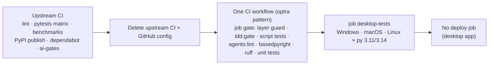

# Replace upstream CI with our own optra-style CI (desktop app, no deploy)

## Context

pick-a-booth will become a **desktop app** that we build on and ship ourselves. Everything CI-related that came from upstream photobooth-app stops being useful:

- `linter.yml`, `pytests.yml` and `benchmarks.yml` belong to the upstream project.
- `cicd.yml` is upstream's PyPI publish.
- `dependabot.yml` targets a `dev` branch this fork doesn't have.
- The issue templates, PR template and `FUNDING.yml` are upstream's.
- PR #1 added `ai-gates.yml` as a side workflow.

Romeo wants one CI of our own, modeled on optra's `.github/workflows/deploy.yml` "Quality gate" job, without optra's server deploy or backup.

### Task Classification
```
- Intent: replace upstream CI/GitHub config with our own quality-gate CI
- Workflow: INFRASTRUCTURE
- Task Size: MEDIUM
- Domain: tooling (CI, scripts, docs) — no src/photobooth change
- Risk: MEDIUM — the new gate decides what can merge; deleting upstream CI is reversible by revert
- Contract Areas: none
- Next Action: approve → branch → RED → implement
```

### Flowchart


### Metadata
- Docs loaded: `planning.md, plan-template.md` (this repo's `docs/ai/` from PR #1).
- Claims reversed while investigating: none.
- Detected running model: Opus 5.5. All phases `Opus 5.5, high`, so they run back-to-back.
- Branch: `infra/no-ticket-desktop-ci`, **stacked on PR #1**. It is cut from `origin/infra/no-ticket-ai-workflow-port` because it reuses `tdd:gate`, `agents:lint` and the docs from PR #1. Its PR targets that branch, and I retarget it to `main` once PR #1 merges.
- Reference (read-only): optra `.github/workflows/deploy.yml` (`ci` job), `scripts/check-test-layers.sh` + `.spec.sh`, `.github/PULL_REQUEST_TEMPLATE.md`.

## What gets removed (all upstream)

- `.github/workflows/linter.yml`, `pytests.yml`, `benchmarks.yml`, `cicd.yml`
- `.github/workflows/ai-gates.yml`, folded into the new CI
- `.github/dependabot.yml`
- `.github/ISSUE_TEMPLATE/bug_report.md`, `feature_request.md`
- `.github/pull_request_template.md`, replaced by our own (below)
- `FUNDING.yml` (upstream author's sponsor link)
- `README.md` lines 6–8 (upstream lint/pytest/codecov badges), replaced by one badge for our CI. The rest of the README (product text, PyPI/crowdin/donate links) is product copy, not CI, so it stays and is flagged as a follow-up.

**Not touched:** `Dockerfile`/`.dockerignore` (packaging, not CI) and `uv run poe benchmark` (still runs locally).

## Phases (all `Opus 5.5`, high)

### Phase 0: Preflight
1. Run `git fetch origin`, then `scripts/new-task-worktree.sh infra desktop-ci`. The script branches from `origin/main`, so I'll run the equivalent `git worktree add --no-track .claude/worktrees/infra-desktop-ci -b infra/no-ticket-desktop-ci origin/infra/no-ticket-ai-workflow-port` instead. This is a deliberate deviation for the stacked branch.
2. Run `uv venv --system-site-packages && uv sync`.
3. Save this plan to `docs/plans/desktop-ci.md` and commit it alone.

### Phase 1: RED for the test-layer guard
The guard is optra's per-commit rule, ported to Python like the rest of our tooling (D1 from PR #1). Write `scripts/tests/test_check_test_layers.py` first, using `scripts/tests/repo_fixture.py` `make_repo()`. Cases are ordered error > edge > regression > happy:
- **error:**
  - A service change without a test in `src/tests/tests/services/` fails.
  - A router change without a router test fails.
  - A migration without a `test_*migration*.py` fails.
  - A `Test-Layers-Skip:` line in the body, not a trailer, doesn't count.
- **edge:**
  - A docs-only commit passes.
  - A test in the wrong area doesn't count.
  - Deleted files are ignored.
  - An empty or all-zero base falls back to the merge-base with `origin/main`, and passes with nothing checked if there is no base.
  - `__init__.py`-only and `scripts/` changes are not policed.
- **regression:** each commit is judged on its own; a later commit's test does not excuse an earlier commit.
- **happy:**
  - A backend change with its test in the same commit passes.
  - A real `Test-Layers-Skip: <reason>` trailer passes and the reason is printed.

Run `uv run poe tdd:red` and commit as `test(ci): RED for test-layer guard`.

### Phase 2: Guard + CI workflow
**`scripts/ci/check_test_layers.py`** (stdlib, reuses the `git()` pattern from `scripts/ci/tdd_gate.py`). For each non-merge commit in `base..head`, considering files with `--diff-filter=ACMR`, these layers need a test changed **in the same commit**:

| Changed path | Needs a test changed in |
|---|---|
| `src/photobooth/routers/api/**.py` | `src/tests/tests/router/api/` |
| `src/photobooth/routers/api_admin/**.py`, `routers/auth_dependencies_bearer.py` | `src/tests/tests/router/api_admin/` or `src/tests/tests/router/test_authentication.py` |
| `src/photobooth/routers/*.py` (media, userdata, static) | `src/tests/tests/router/` |
| `src/photobooth/services/backends/**.py` | `src/tests/tests/backends/` |
| `src/photobooth/services/mediaprocessing/**.py`, `services/processor/**.py` | `src/tests/tests/mediaprocessing/` or `src/tests/tests/services/` |
| other `src/photobooth/services/**.py` | `src/tests/tests/services/` |
| `src/photobooth/plugins/**.py` | `src/tests/tests/plugins/` |
| `src/photobooth/utils/**.py` | `src/tests/tests/utils/` |
| `src/photobooth/database/alembic/versions/*.py` | a `src/tests/tests/**/test_*migration*.py` |
| any other `src/photobooth/**.py` (app core) | any `src/tests/tests/**/test_*.py` |

`__init__.py` files that only re-export are exempt. The escape hatch is a `Test-Layers-Skip: <reason>` git trailer, read with `%(trailers:key=Test-Layers-Skip,valueonly)`. Exit codes: 0 ok, 1 missing tests, 2 usage error.

**`.github/workflows/ci.yml`**, named "CI" (optra's `ci` job shape, minus services and deploy):
- Triggers: `push`, `pull_request`, `workflow_dispatch`. No `paths-ignore`: docs are validated by `test_doc_links.py`, so a docs-only PR still runs the gate. This differs from optra on purpose.
- `permissions: contents: read`; concurrency `ci-${{ github.ref }}` with cancel-in-progress.
- **Job `gate`** (ubuntu-latest, py 3.14, `fetch-depth: 0`, timeout 30). Steps:
  1. Test-layer guard. Same base rule as optra: a push to main uses `event.before`, otherwise `merge-base HEAD origin/<target>`. SHAs are passed via `env`.
  2. Set up uv (`astral-sh/setup-uv@v8.2.0`), the same apt line as today, `uv sync --all-extras --dev`.
  3. TDD gate, PR only (`TDD_GATE_BASE`, `TDD_GATE_HEAD_REF`, `PR_BODY` via `env`).
  4. Script tests: `uv run poe test:scripts`.
  5. Agents lint: `uv run poe agents:lint`.
  6. Type-check: `uv run basedpyright`.
  7. Lint: `uv run ruff check` and `uv run ruff format --check`.
  8. Unit tests: `uv run poe test`.
- **Job `desktop-tests`** (`needs: gate`; desktop users run Windows, macOS and Linux): matrix `os: [ubuntu-latest, windows-latest, macos-latest]` × `python: ["3.11", "3.14"]` (lowest and highest of `requires-python >=3.11`). Steps: checkout, setup-uv, apt deps on Linux only, `uv sync`, `uv run pytest --basetemp=./tests_tmp/ src/tests/tests`.
- No deploy, backup, PyPI or codecov jobs.

**Other changes:**
- **`.github/pull_request_template.md`**: our own, optra's structure in English only. Sections: Summary (plain language), What changes, How to test, Change Type, Evidence, Testing, TDD evidence (matrix, RED run from `uv run poe tdd:red`, `TDD-Waiver:`/`Migration-Waiver:` lines), Risk, Rollback.
- **Deletions:** as listed above.
- **`pyproject.toml`**: add poe task `"ci:layers" = "python scripts/ci/check_test_layers.py"`, so the same command works locally.

### Phase 3: Docs sync (fixes the doc links the deletions would break)
- `CLAUDE.md`:
  - "What it is" now says the app is headed to a desktop app built on the fork.
  - The Tech stack CI line becomes `.github/workflows/ci.yml`; drop the upstream PyPI/RPi line.
  - Drop the "Don't edit upstream-owner-gated CI jobs" bullet.
- `docs/ai/handoff.md` "Release flow": required checks are `CI / gate` + `CI / desktop-tests`. No deployment; desktop packaging/release is a future task.
- `docs/ai/testing-strategy.md`: Enforcement table points to `ci.yml`; add the test-layer guard row and the `Test-Layers-Skip:` trailer.
- `docs/ai/risk-register.md`:
  - The "CI gates" row points to `ci.yml`.
  - Remove the dependabot residual.
  - Add a row: there are no dependency updates now that dependabot is gone, so dependency bumps are manual.
- `docs/ai/dev-environment.md`, `docs/ai/architecture-manifest.md`, `docs/ai/file-index/repository-map.md`, `docs/ai/pr-evidence.md`: replace references to the removed workflows and template sections; add the guard to the tooling list.
- `scripts/generate_agent_defs.py` docstring: `ai-gates.yml` becomes `ci.yml`.
- `.ai-engineering/memory/architecture-decisions.md`: add ADR-0003 "Desktop app; own CI, no server deploy".

### Phase 4: Validate, graphify, handoff
- Graphify incremental update (code AST + changed docs semantic).
- Push, then open a PR into `infra/no-ticket-ai-workflow-port` (`--repo OwlRepo/pick-a-booth`), in English with no AI trailer. Wait for `gh pr checks` green. No merge.

## Validation
- `uv run poe test:scripts`: all green, including the new guard tests and `test_doc_links.py` (no dangling references to deleted workflows).
- `uv run poe ci:layers origin/infra/no-ticket-ai-workflow-port HEAD` on the branch passes. The guard and its tests land in the same commit, and docs commits are not policed.
- `uv run poe agents:lint`, `uv run ruff check`, `uv run ruff format --check`, `uv run basedpyright scripts`: clean.
- `TDD_GATE_BASE=origin/infra/no-ticket-ai-workflow-port uv run poe tdd:gate`: `ok`.
- Workflow YAML parses (`yaml.safe_load`). After push, `gh pr checks` shows `gate` plus the 6 `desktop-tests` jobs green, and none of the old upstream checks run.
- `grep -rn "pytests.yml\|linter.yml\|cicd.yml\|ai-gates\|dependabot" --exclude-dir=docs/plans` returns nothing.

## Rollback
Everything is reversible: close the PR, or `git revert -m 1 <merge>` to restore the upstream workflows.

## Residual risks / follow-ups
- Branch protection is off, so the gate is advisory until `CI / gate` (and `desktop-tests`) are made required checks. That's your call.
- Windows/macOS runners have no `ffmpeg`/`rclone`, so tests needing them self-skip there (same as upstream today).
- Without dependabot, dependency updates are manual (`uv run poe list_outdated`).
- Not in this task: desktop packaging/installers (PyInstaller/Briefcase etc.) and a release workflow, plus README product text (PyPI/crowdin/donate links).
